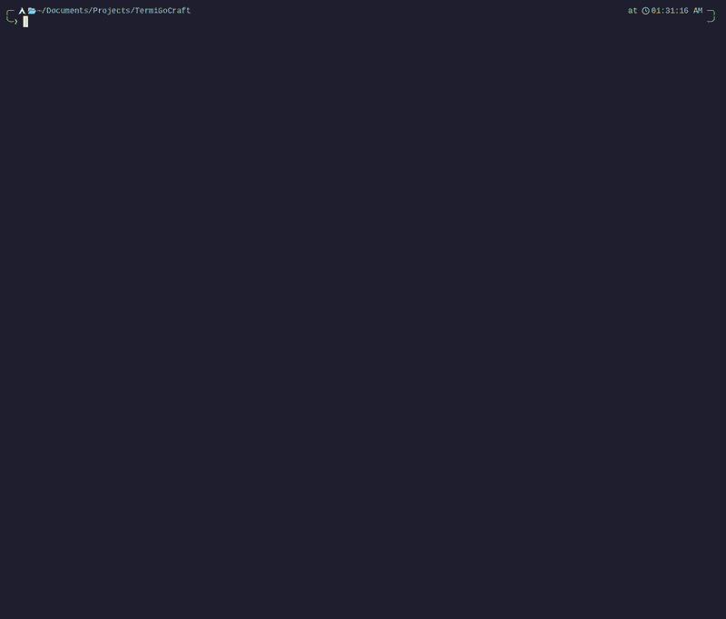

<div align="center">

# 🧱 TermiGoCraft

**A first-person, Minecraft-style voxel world — rendered entirely in your terminal, in Go.**

No game engine. No GPU. Just a hand-written software raycaster painting truecolor
half-block pixels into a terminal, with real physics and ray-traced lighting.

[](https://github.com/tyler-void/TermiGoCraft/actions/workflows/ci.yml)
[](https://goreportcard.com/report/github.com/tyler-void/TermiGoCraft)


[](LICENSE)

</div>

<p align="center">
  
</p>

---

## ✨ What it does

- 🎥 **First-person 3D in a terminal** — walk through a solid, blocky world rendered with truecolor.
- ⛏️ **Build & mine** — break and place blocks with a live aiming cursor and a block hotbar.
- 🌍 **Gravity & collision** — a real physics body: you stand on the ground, bump into walls (and slide along them), and jump. Toggle a creative **free-fly** mode with `G`.
- 🌅 **Ray-traced lighting** — a directional sun with **hard cast shadows** and **ambient occlusion**, computed live. Toggle with `L`.
- ⚡ **Zero-allocation render loop** — the steady-state frame allocates **nothing** on the heap; benchmarks enforce it.
- 📦 **One dependency** — just [`tcell/v2`](https://github.com/gdamore/tcell) for terminal I/O. Everything 3D is hand-rolled.

## 🧠 How it works

The interesting part. Every technique here is written from scratch.

| Technique | What it does |
|---|---|
| **Voxel raycaster** (Amanatides & Woo DDA) | One ray per pixel marches the voxel grid to the first solid block. No meshing — the world is just a flat `[]byte`. Cost scales with screen size, not world size. |
| **Half-block pixels** (`▀` + truecolor) | Each terminal cell is split into two independently-colored pixels (foreground = top, background = bottom), doubling vertical resolution. |
| **Hybrid renderer** | The voxel world (raycast) and entities/held-item/selection (triangle rasterizer) write into **one shared color + depth buffer**, so occlusion between them is automatically correct — a mob behind a wall is hidden. |
| **Ray-traced lighting** | At each hit: directional `n·L` shading, **one shadow ray** toward the sun (reusing the same DDA), and **voxel ambient occlusion** (the 0fps `vertexAO` rule, bilinearly interpolated per pixel). Fully deterministic → no shimmer. |
| **AABB physics** | A swept axis-aligned box resolves collisions per axis against the voxel field (clamp + zero-velocity → wall sliding), integrated on a fixed timestep with gravity and jumping. |
| **Zero-alloc discipline** | Flat preallocated framebuffers, a pointer-free `[]byte` world, value-typed math, and a dirty-cell present (an idle view touches the terminal *not at all*). |

## 🏗️ Architecture

A small set of one-way-dependent packages; the engine logic is **renderer-agnostic** (only `render` and input touch the terminal).

```
main.go            terminal setup + clean restore
internal/
├── geom/          Vec3, RGB, Triangle  (pure value types)
├── world/         flat []Block grid · terrain gen · DDA Cast · break/place
├── camera/        first-person camera · basis vectors · per-pixel rays
├── physics/       AABB body · gravity · per-axis voxel collision · jump · fly
├── render/        shared framebuffer · raycaster · rasterizer · lighting · HUD
├── entity/        non-block meshes (and the held item)
├── input/         key → action mapping
└── game/          state + fixed-timestep loop (input on its own goroutine)
```

`geom ← world · camera · physics · render ← game` — no cycles; pure-logic packages have no terminal dependency and are tested headlessly.

## 📊 Performance

Measured at the default 120×40 terminal (240×80 pixels) on a dev machine:

| Benchmark | Time | Allocations |
|---|---|---|
| Lit world frame (clear + raycast + shadows + AO) | **~1.9 ms** | **0 B/op, 0 allocs/op** |
| Present (pack + flush, idle) | ~45 µs | **0 allocs/op** |

That's comfortably inside the 33 ms / 30 FPS budget — the zero-allocation design keeps the GC quiet and the frame time flat over long sessions.

## 🚀 Quick start

```bash
git clone https://github.com/tyler-void/TermiGoCraft.git
cd TermiGoCraft
go run .          # or: make run  /  make build && ./termigocraft
```

Requires **Go 1.24+** and a **truecolor terminal** ([kitty](https://sw.kovidgoyal.net/kitty/) recommended; any terminal exporting `COLORTERM=truecolor` works, others fall back to the nearest palette).

## 🎮 Controls

| Keys | Action |
|------|--------|
| `W` `A` `S` `D` | move (relative to facing) |
| `Space` | jump (walking) / ascend (flying) |
| `C` | descend (flying) |
| Arrow keys | look around |
| `F` / `Enter` | break the targeted block |
| `R` | place the selected block |
| `Q` / `E` or `1`–`9` | select block type |
| `G` | toggle walk / fly |
| `L` | toggle lighting (sun + shadows) |
| `H` / `?` | toggle help |
| `Esc` / `Ctrl+C` | quit |

## 🧪 Development

```bash
make test     # 51 tests across 8 packages, all headless (no terminal needed)
make bench    # render benchmarks — assert 0 allocs/op
make vet      # go vet
make fmt      # gofmt
```

Tests cover the vector math, DDA traversal, world edits, camera, input mapping,
**cross-pass occlusion**, **physics** (rest/slide/jump/head-bump/unstick/bounds),
and **lighting** (shadows/directional/AO/determinism) — plus allocation benchmarks
that guard the zero-alloc render path.

## 📐 Spec-driven

This project was built with [Spec Kit](https://github.com/github/spec-kit): each feature
went **spec → plan → tasks → implement**. The full design history lives in
[`specs/`](specs/) — requirements, the research behind each decision (with sources),
data models, and contracts. Worth a read if you like seeing the *why* behind the code.

## 🗺️ Honest limitations & what's next

This is a **proof of concept** — and a fun one. A terminal has hard ceilings a native
window doesn't: low cell resolution, escape-sequence throughput, and no key-release
events. So it'll never be as buttery as a GPU game, and that's fine.

Because the engine is renderer-agnostic, the natural next step would be pointing the same
`world` + `physics` + raycast logic at a real GPU window (ebiten / go-gl) for a smooth
native build — the terminal-specific code is isolated to `render` and `input`.

Other ideas left on the table: reflections / water, global illumination, a day/night
cycle, world save/load, and true hold-to-move via the kitty keyboard protocol.

## 📚 References

- [Amanatides & Woo — *A Fast Voxel Traversal Algorithm*](http://www.cse.yorku.ca/~amana/research/grid.pdf) (the raycaster)
- [0fps — *Ambient occlusion for Minecraft-like worlds*](https://0fps.net/2013/07/03/ambient-occlusion-for-minecraft-like-worlds/) (the AO rule)
- [Gaffer on Games — *Fix Your Timestep*](https://gafferongames.com/post/fix_your_timestep/) (fixed-step physics)
- [`tcell`](https://github.com/gdamore/tcell) — truecolor terminal I/O

## 📄 License

[MIT](LICENSE) © Tyler
